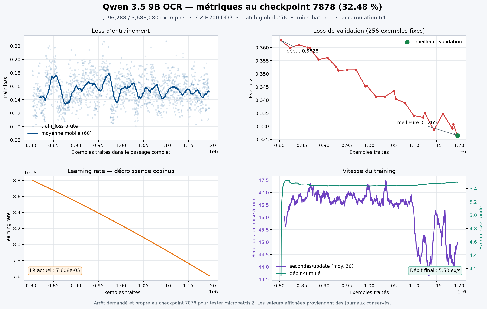

# Qwen 3.5 9B OCR — LoRA fine-tuning

Code and technical evidence for adapting `Qwen/Qwen3.5-9B` to OCR with LoRA on OpenShift and NVIDIA H200 GPUs.

## Current training state

- Model: `Qwen/Qwen3.5-9B`, pinned revision `c202236235762e1c871ad0ccb60c8ee5ba337b9a`
- Method: BF16 LoRA, rank `16`, alpha `32`
- Training context limit: `8192` combined tokens
- Optimizer: AdamW
- Learning-rate schedule: cosine, `1e-4` peak to `1e-5`, driven by processed examples
- Distributed mode: four-rank DDP/HSDP replication on 4× H200
- Requested continuation: physical microbatch `3` per GPU, accumulation `32`, global batch `384`
- Verified retained checkpoint: step `7878`, `1,196,288 / 3,683,080` examples (`32.48%`)
- Checkpoint SHA-256: `21fa40cbe4d2f1f7f787c950635f698667bc6c45cb198d1773a54b9412b1b56e`
- Best evaluation loss at that checkpoint: `0.3265333178`

The microbatch-3 continuation performs a real-update, finite-gradient, parameter-update, kernel-execution, checkpoint and exact-replay preflight before durable training continues. This configuration is experimental because long OCR sequences can create substantially higher memory peaks than short smoke tests.



## Repository layout

- `scripts/`: dataset preparation, optimized training, four-GPU continuation, OpenShift launcher and performance benchmark
- `tests/`: deterministic data-stream, resume, preparation and integrity tests
- `docs/`: architecture, model, data, multi-GPU, checkpoint and troubleshooting notes
- `metrics/`: training dashboard and checkpoint-7878 metric summaries

## Data and secrets

This repository deliberately excludes:

- OCR datasets and MinIO objects
- base-model weights and LoRA checkpoints
- OpenShift tokens, S3 credentials and passwords
- generated caches and local runtime environments

Credentials must be supplied at runtime through environment variables or an OpenShift Secret. See [SECURITY.md](SECURITY.md).

## Runtime configuration

The current trainer expects the optimized GPU runtime used by the project:

- PyTorch with CUDA/Hopper support
- `fla-core==0.5.2`
- `causal-conv1d==1.7.0`
- Triton `3.7.1`
- an OpenShift-mounted project volume containing the pinned model and prepared dataset metadata

The main continuation entry point is:

```text
scripts/train_optimized_resume_gpu4_m3_from7878_v1.py
```

The corresponding OpenShift launcher is:

```text
scripts/launch_optimized_resume_gpu4_m3_from7878_v1.py
```

The launcher requests four GPUs and leaves node placement to the OpenShift scheduler. Review project-specific paths, Secret names and resource limits before running it in another namespace.

## Validation evidence

At checkpoint 7878:

- latest train loss: `0.150908`
- median train loss over the last 100 updates: `0.150066`
- evaluation loss: `0.362801 → 0.326533`
- relative evaluation-loss improvement: approximately `10.0%`
- measured throughput for the prior microbatch-1 continuation: `5.497 examples/s`

Raw training data is not published here. The validation CSV contains only numerical training metrics.

